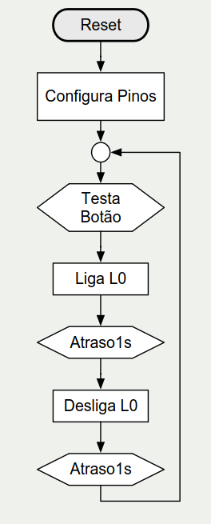
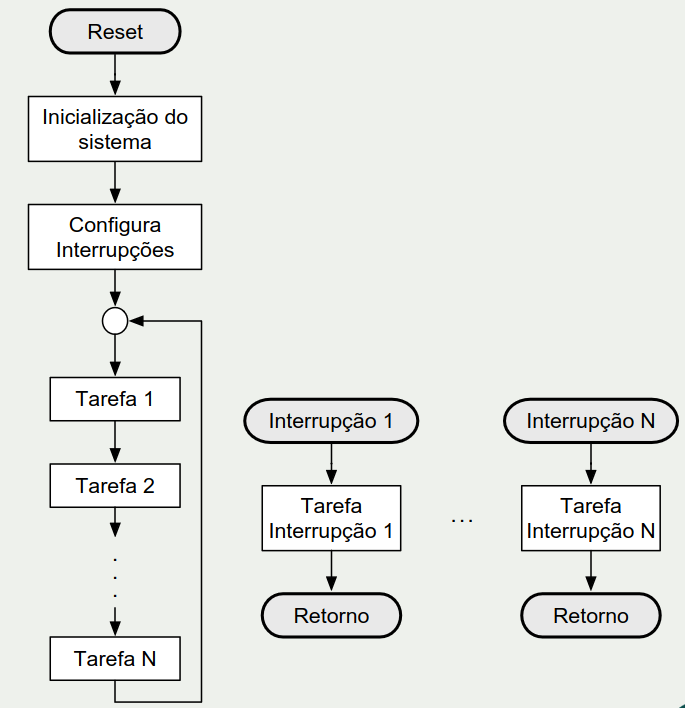
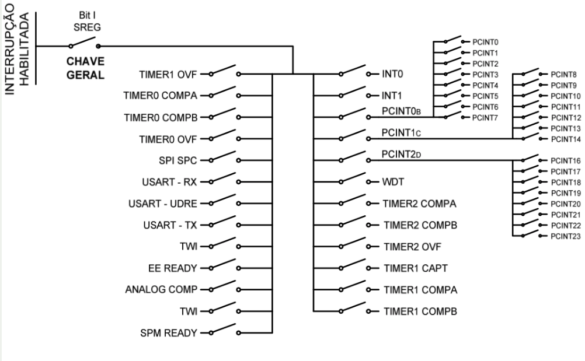
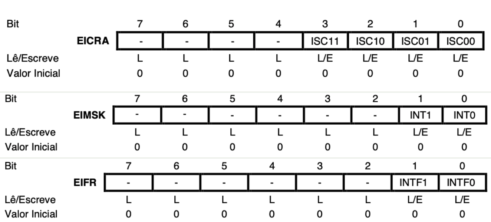
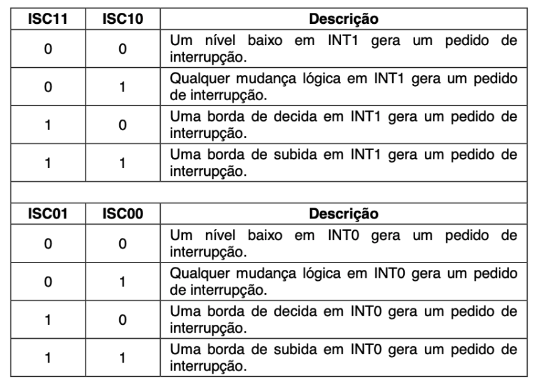
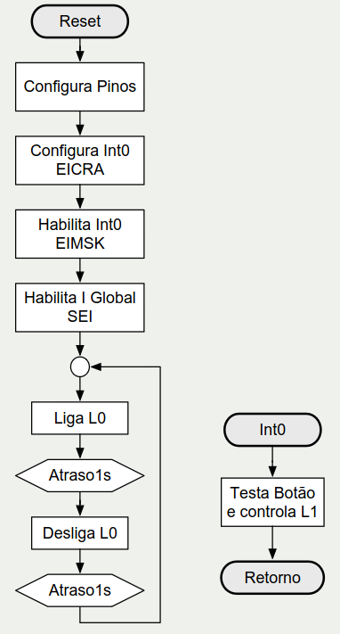
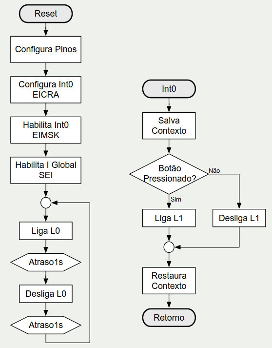

# Programando com Interrupções — Interrupção Externa do ATmega328p

[slides](../materiais/slides/prova_03/interrupcaoExterna.pdf)

---

## 1. Software embarcado básico: Round-Robin ("loopão")

- Estrutura mais simples: configura o sistema logo após o **reset** e executa as **tarefas de forma sequencial e repetida** em um laço infinito.
- Fluxo: Reset → Inicialização do sistema → (laço) Tarefa 1 → Tarefa 2 → ... → Tarefa N → volta ao laço.
- Vantagem: **simplicidade**.

---

## 2. Motivação: o desafio e o problema da falta de interatividade

**Desafio:** sistema com um botão (**PD2**) e dois LEDs, **L0 (PB0)** e **L1 (PB1)**. O L0 deve piscar a cada 2 s (1 s ligado, 1 s desligado) e, quando o botão for pressionado, o L1 deve acender.

<p align="center">
  
</p>

**Solução em Round-Robin:** a cada volta do laço, chama `testa_botao`, depois pisca o L0 com dois atrasos de 1 s.

```asm
.INCLUDE <m328pdef.inc>

.equ BOTAO = PD2
.equ L0 = PB0
.equ L1 = PB1
.def AUX = R16

setup:
  ldi AUX, 0b00000011
  out DDRB, AUX        ; configura PB1/PB0 como saída
  out PORTB, AUX       ; desliga os LEDs (LEDs ativos em baixo)
  cbi DDRD, BOTAO      ; configura o PD2 como entrada
  sbi PORTD, BOTAO     ; liga o pull-up do PD2

main:
  rcall testa_botao

  sbi PORTB, L0        ; desliga L0
  ldi r19, 80
  rcall delay          ; delay 1s

  cbi PORTB, L0        ; liga L0
  ldi r19, 80
  rcall delay          ; delay 1s

  rjmp main

;---------------------------------------------------
; Sub-rotina: Testa BOTAO e liga L1 se pressionado
;---------------------------------------------------
testa_botao:
  sbic PIND, BOTAO     ; botão pressionado: salta a próxima instrução
  rjmp desliga
  cbi PORTB, L1        ; liga L1
  rjmp fim
desliga:
  sbi PORTB, L1        ; desliga L1
fim:
  ret
```

> **Problema: falta de interatividade.** O botão só é testado **uma vez por volta** do laço, ou seja, uma vez a cada ~2 s. Se o botão for pressionado e solto entre dois testes, o evento é **perdido**, e a resposta pode demorar até 2 s.

---

## 3. Conceito geral de interrupção

- **Interrupção** é um processo pelo qual um dispositivo **externo ou interno** interrompe a execução da tarefa atual do microcontrolador e solicita a execução de **outra**.
- Vantagem principal: vários processos podem ser executados "em paralelo" e as condições configuradas são tratadas **no devido tempo**.
- Exemplos de causas de interrupção:
  - um certo tempo configurado passou;
  - uma mensagem chegou por um canal de comunicação;
  - um botão foi pressionado.
- **Problema em aberto:** e se duas ou mais interrupções ocorrerem ao mesmo tempo? (resolvido pela **prioridade fixa**, ver seção 5)

### Round-Robin com interrupções

- **Eventos urgentes** geram interrupções:
  - tarefas de **alta prioridade** são tratadas dentro das **rotinas de interrupção (ISR)**;
  - tarefas de **baixa prioridade** continuam como tarefas Round-Robin no **laço principal**.
- Fluxo: Reset → Inicialização → **Configura interrupções** → (laço) Tarefa 1 ... Tarefa N. Em paralelo, cada fonte tem seu fluxo: Interrupção N → Tarefa da interrupção → Retorno.

<p align="center">
  
</p>

### Round-Robin clássico vs. com interrupções

| | Prós | Contras |
|---|---|---|
| **Com interrupções** | Evita gastar CPU com verificações desnecessárias; execução **não bloqueante**; permite usar **modos de economia de energia** de forma mais eficiente | Muda o paradigma linear de execução; **imprevisibilidade** (interrupções assíncronas); maior complexidade (**variáveis compartilhadas** (como SREG), **condições de corrida** (como vários fluxos de execução tentando ler e alterar o mesmo dado)) |

---

## 4. Características das interrupções na família AVR ATmega

- Interrupções **vetoradas** (cada fonte tem seu endereço fixo na Flash).
- **Aninhamento não é automático** (por padrão, uma ISR não é interrompida por outra).
- **Prioridade fixa** (definida pela posição do vetor).
- **Todas são mascaráveis** (podem ser habilitadas/desabilitadas).
- **Habilitação global:** bit **I** do **SREG**.

### Esquema de habilitação

<p align="center">
  
</p>

Para uma interrupção ser atendida, duas "chaves" precisam estar fechadas:

1. a **chave geral** (bit I do SREG);
2. a **chave individual** da fonte (ex.: bit INT0 no EIMSK).

Ainda há "subchaves" para as interrupções de mudança de pino: PCINT0 (PCINT0–7, porta B), PCINT1 (PCINT8–14, porta C) e PCINT2 (PCINT16–23, porta D).

---

## 5. Processo de interrupção (passo a passo)

1. A CPU **completa a instrução em andamento**.
2. **Desvio para o vetor de interrupção:**
   - salva na pilha o **endereço de retorno** (próxima instrução que seria executada);
   - desvia para a posição de memória do **vetor** correspondente;
   - **zera a flag** da interrupção atendida;
   - **desabilita as interrupções globalmente** (bit I do SREG = 0).
3. **Executa o código** da interrupção (ISR).
4. Ao encontrar **`reti`** (*Return from Interruption*):
   - carrega no PC o endereço de retorno salvo na pilha;
   - **habilita as interrupções globalmente** (bit I = 1).
5. A execução **continua de onde foi interrompida**.

> ⚠️ É preciso **salvar o contexto** do **SREG** e dos registradores usados na rotina de interrupção (push no início, pop na ordem inversa antes do `reti`).

Lembrete (aula de pilha): `reti`, assim como `ret`, incrementa o SP em **2** (endereço de retorno de 16 bits).

---

## 6. Vetores de interrupção do ATmega328p

Cada vetor ocupa **2 endereços de palavra** (espaço para um `rjmp`). Quanto menor o número do vetor, **maior a prioridade**.

| Nº | Endereço | Fonte | Descrição |
|---|---|---|---|
| 1 | `0x0000` | RESET | Pino externo, power-on, brown-out e watchdog reset |
| 2 | `0x0002` | **INT0** | Interrupção externa 0 |
| 3 | `0x0004` | **INT1** | Interrupção externa 1 |
| 4 | `0x0006` | PCINT0 | Mudança de pino 0 |
| 5 | `0x0008` | PCINT1 | Mudança de pino 1 |
| 6 | `0x000A` | PCINT2 | Mudança de pino 2 |
| 7 | `0x000C` | WDT | Estouro do watchdog |
| 8 | `0x000E` | TIMER2 COMPA | Comparação A do Timer/Counter2 |
| 9 | `0x0010` | TIMER2 COMPB | Comparação B do Timer/Counter2 |
| 10 | `0x0012` | TIMER2 OVF | Overflow do Timer/Counter2 |
| 11 | `0x0014` | TIMER1 CAPT | Captura do Timer/Counter1 |
| 12 | `0x0016` | TIMER1 COMPA | Comparação A do Timer/Counter1 |
| 13 | `0x0018` | TIMER1 COMPB | Comparação B do Timer/Counter1 |
| 14 | `0x001A` | TIMER1 OVF | Overflow do Timer/Counter1 |
| 15 | `0x001C` | TIMER0 COMPA | Comparação A do Timer/Counter0 |
| 16 | `0x001E` | TIMER0 COMPB | Comparação B do Timer/Counter0 |
| 17 | `0x0020` | TIMER0 OVF | Overflow do Timer/Counter0 |
| 18 | `0x0022` | SPI, STC | Transferência SPI completa |
| 19 | `0x0024` | USART, RX | Recepção USART completa |
| 20 | `0x0026` | USART, UDRE | Registrador de dados USART vazio |
| 21 | `0x0028` | USART, TX | Transmissão USART completa |
| 22 | `0x002A` | ADC | Conversão do ADC completa |
| 23 | `0x002C` | EE READY | EEPROM pronta |
| 24 | `0x002E` | ANALOG COMP | Comparador analógico |
| 25 | `0x0030` | TWI | Interface serial de 2 fios |
| 26 | `0x0032` | SPM READY | Memória de programa pronta |

- O **primeiro endereço livre** depois dos vetores é `0x0034` (usado no exemplo com `.ORG 0x0034`).
- Os vetores de interesse da aula: **RESET (`0x0000`)**, **INT0 (`0x0002`)** e **INT1 (`0x0004`)**.

---

## 7. Interrupção externa (INT0 e INT1)

Os pinos de interrupção externa são **INT0 = PD2** e **INT1 = PD3**. Três registradores controlam o recurso:

| Registrador | Nome | Função |
|---|---|---|
| **EICRA** | External Interrupt Control Register A | Define **qual evento** no pino gera o pedido (nível/borda) |
| **EIMSK** | External Interrupt Mask Register | **Habilita** (1) ou mascara (0) INT0 e INT1 |
| **EIFR** | External Interrupt Flag Register | **Flags** INTF0 e INTF1 (pedido pendente) |

Endereços de I/O (SRAM): `EIMSK` = `0x1D` (`0x3D`), `EIFR` = `0x1C` (`0x3C`). O **EICRA fica na área estendida**, por isso é acessado com **`sts`/`lds`** (e não com `out`).

### Bits dos registradores

<p align="center">
  
</p>

- Valor inicial de todos: **0** (interrupções desabilitadas).
- Os bits não usados são somente leitura (L), e os bits de configuração são leitura/escrita (L/E).

### EICRA: sensibilidade do pino

| ISC11 | ISC10 | INT1 gera pedido com... | ISC01 | ISC00 | INT0 gera pedido com... |
|---|---|---|---|---|---|
| 0 | 0 | **Nível baixo** | 0 | 0 | **Nível baixo** |
| 0 | 1 | **Qualquer mudança lógica** | 0 | 1 | **Qualquer mudança lógica** |
| 1 | 0 | **Borda de descida** | 1 | 0 | **Borda de descida** |
| 1 | 1 | **Borda de subida** | 1 | 1 | **Borda de subida** |

<p align="center">
  
</p>

---

## 8. Exemplo completo: botão por interrupção (INT0)

**Fluxograma:**
<p align="center">
  
</p>

<p align="center">
  
  
</p>

- **Principal:** Reset → Configura pinos → Configura INT0 (**EICRA**) → Habilita INT0 (**EIMSK**) → Habilita I global (**`sei`**) → (laço) Liga L0 → Atraso 1 s → Desliga L0 → Atraso 1 s.
- **Int0:** Salva contexto → Botão pressionado? (Sim: liga L1 / Não: desliga L1) → Restaura contexto → Retorno.

```asm
.INCLUDE <m328Pdef.inc>

;DEFINIÇÕES
.equ BOTAO = PD2
.equ L0 = PB0        
.equ L1 = PB1
.def AUX = R16 
  
.ORG 0x0000        ; Reset vector
  RJMP setup       

.ORG 0x0002	   ; Vetor (endereço na Flash) da INT0
  RJMP isr_int0     

.ORG 0x0034        ; primeira end. livre depois dos vetores
setup:
  ldi AUX,0x03     ; 0b00000011   
  out DDRB,AUX     ; configura PB1/0 como saída
  out PORTB,AUX    ; desliga os LEDs
  cbi DDRD, BOTAO  ; configura o PD2 como entrada
  sbi PORTD, BOTAO ; liga o pull-up do PD2

  ldi AUX, 0x01    ; 
  sts EICRA, AUX   ; config. INT0 sensível a borda
  sbi EIMSK, INT0  ; habilita a INT0
                    
  sei              ; habilita a interrupção global ... 
                   ; ... (bit I do SREG)
main:
  sbi  PORTB,L0    ; desliga L0
  ldi r19, 80 
;  rcall delay      ; delay 1s
  cbi  PORTB,L0    ; liga L0
  ldi r19, 80 
;  rcall delay      ; delay 1s
  rjmp main

;-------------------------------------------------
; Rotina de Interrupção (ISR) da INT0
;-------------------------------------------------
isr_int0:
  push R16	  ; Salva o contexto (SREG)
  in R16, SREG
  push R16
  
  sbic PIND,BOTAO ; botao press. salta a próxima inst.
  rjmp desliga
  cbi  PORTB,L1   ; liga L1
  rjmp fim
desliga:
  sbi  PORTB,L1   ; desliga L1

fim:
  pop R16	  ; Restaura o contexto (SREG)
  out SREG,R16
  pop R16
  reti            ; retorna da interrupcao

;------------------------------------------------------------
;SUB-ROTINA DE ATRASO Programável
;Depende do valor de R19 carregado antes da chamada.
;Exemplos: 
; - R19 = 16 --> 200ms 
; - R19 = 80 --> 1s 
;------------------------------------------------------------
delay:           
  push r17	 ; Salva os valores de r17,
  push r18	 ; ... r18,
  in r17,SREG    ; ...
  push r17       ; ... e SREG na pilha.

  ; Executa sub-rotina :
  clr r17
  clr r18
loop:            
  dec  R17       ;decrementa R17, começa com 0x00
  brne loop      ;enquanto R17 > 0 fica decrementando R17
  dec  R18       ;decrementa R18, começa com 0x00
  brne loop      ;enquanto R18 > 0 volta decrementar R18
  dec  R19       ;decrementa R19
  brne loop      ;enquanto R19 > 0 vai para volta

  pop r17         
  out SREG, r17  ; Restaura os valores de SREG,
  pop r18        ; ... r18
  pop r17        ; ... r17 da pilha

  ret
```

Pontos do exemplo:

- **Estrutura da tabela de vetores:** em `0x0000` fica um `rjmp setup` (reset) e em `0x0002` um `rjmp isr_int0`. Os `.ORG` posicionam cada instrução no endereço certo.
- **`.ORG 0x0034`** coloca o código principal depois da tabela de vetores, para não sobrescrevê-la.
- **Ordem de configuração:** pinos → sensibilidade (EICRA) → habilitação individual (EIMSK) → habilitação global (`sei`).
- **`sts EICRA`**: o EICRA está na área estendida de I/O, então não dá para usar `out`; já o **EIMSK** está nos I/O baixos e aceita `sbi`.
- **ISR:** salva `R16` e o **SREG** na pilha e restaura na ordem inversa, depois `reti`.
- Dentro da ISR o botão é testado de novo (`sbic PIND, BOTAO`) para decidir se liga ou desliga o L1.
- O laço principal só cuida do L0, e o botão **não depende mais do tempo do delay** (resposta imediata).


---

## 9. Experimentos (slide 20)

- **Testar e gravar** todos os trechos de código apresentados.
- **Modificar** o circuito e o código para funcionar com o botão no **PD3 (INT1)**.

**Roteiro da adaptação para INT1:**

| Item | INT0 (exemplo) | INT1 (exercício) |
|---|---|---|
| Pino do botão | PD2 | **PD3** |
| Vetor | `.ORG 0x0002` → `rjmp isr_int0` | `.ORG 0x0004` → `rjmp isr_int1` |
| Sensibilidade (EICRA) | ISC01:ISC00 (bits 1:0) | **ISC11:ISC10 (bits 3:2)**, ex.: `0x04` para qualquer mudança |
| Habilitação (EIMSK) | `sbi EIMSK, INT0` | `sbi EIMSK, INT1` |
| Pull-up / entrada | `cbi DDRD, PD2` / `sbi PORTD, PD2` | `cbi DDRD, PD3` / `sbi PORTD, PD3` |
| Teste na ISR | `sbic PIND, PD2` | `sbic PIND, PD3` |

> Atenção: o vetor da INT1 fica em `0x0004`. Sem o `.ORG` do vetor, a interrupção não chega à ISR.

---

## 10. Pontos de atenção para a prova

- Interrupção = a CPU **para a tarefa atual**, executa a **ISR** e **volta** de onde parou.
- Para uma interrupção funcionar é preciso: **(1)** habilitar a fonte (ex.: `EIMSK`), **(2)** configurar a sensibilidade (ex.: `EICRA`) e **(3)** habilitar o **bit I** do SREG (`sei`).
- Ao atender: a CPU **empilha o endereço de retorno** (SP − 2), **zera a flag** da interrupção e **limpa o bit I** (interrupções desabilitadas). O **`reti`** desempilha o PC (SP + 2) e **reabilita o bit I**.
- **Aninhamento não é automático**; a **prioridade é fixa** (vetor de menor endereço tem maior prioridade).
- **Salvar contexto na ISR:** registradores usados e **SREG** (`push`/`in SREG`/...; restaurar na ordem inversa). A ISR **não recebe parâmetros** nem retorna valor: se precisar comunicar com o laço principal, use variável na SRAM ou registrador.
- Vetores: **RESET `0x0000`**, **INT0 `0x0002`**, **INT1 `0x0004`** (cada vetor ocupa 2 endereços). O código do programa começa depois da tabela (`0x0034` no ATmega328p).
- **INT0 = PD2** e **INT1 = PD3**.
- **EICRA** (área estendida: `sts`/`lds`), **EIMSK** (`0x1D`) e **EIFR** (`0x1C`) (I/O baixos: aceitam `sbi`/`cbi`).
- **ISCx1 : ISCx0:** `00` nível baixo; `01` qualquer mudança; `10` borda de **descida**; `11` borda de **subida**.
- No exemplo, `EICRA = 0x01` (ISC01:ISC00 = `01`) configura **qualquer mudança lógica**, e não só a borda de descida. Por isso a ISR testa o pino para saber se o botão foi pressionado ou solto.
- Round-Robin com interrupções: **alta prioridade na ISR** (curta e rápida), **baixa prioridade no laço principal**.
- Contras das interrupções: imprevisibilidade, variáveis compartilhadas e **condições de corrida**.