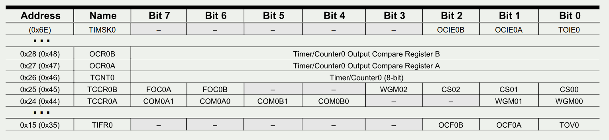
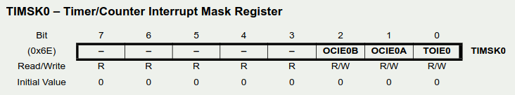
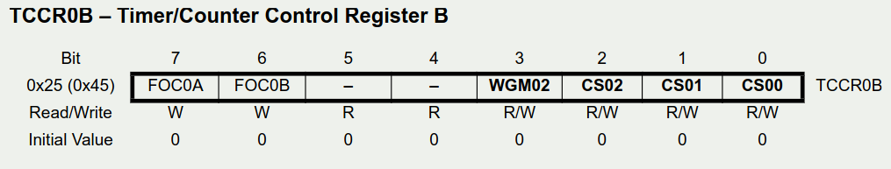
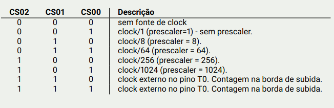
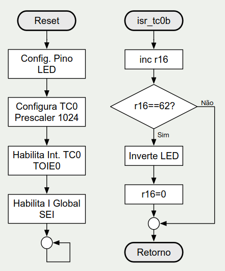
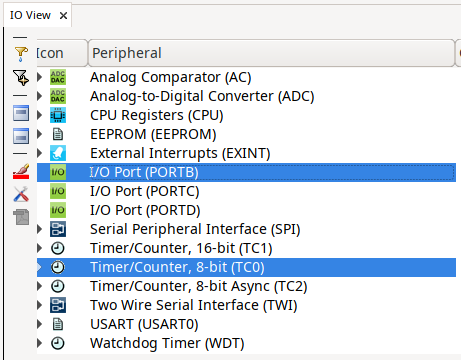
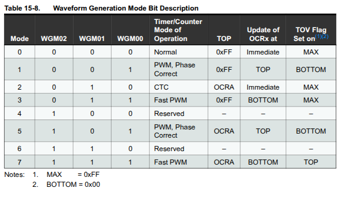

# Temporizador/Contador (T/C) — ATmega328p

[slides](../materiais/slides/prova_04/temporizador_contador_handout.pdf)

## 1. Motivação: como contar tempo com precisão?

### Contagem por número de ciclos (espera ocupada)

Laço duplo com `dec`/`brne`:

```asm
loop:
  dec  r16
  brne loop
  dec  r17
  brne loop
```

Contagem de ciclos do exemplo (R16 e R17 começam em 0, então cada laço roda 256 vezes):

| Trecho | Ciclos |
|---|---|
| Laço interno (R16): `dec` (1) + `brne` com desvio (2) = 3 ciclos × 255 + última volta (`dec` 1 + `brne` sem desvio 1 = 2) | **767** |
| Laço externo (R17): (767 + `dec` 1 + `brne` com desvio 2) × 255 + (767 + `dec` 1 + `brne` sem desvio 1) | **197 119 ciclos** |

> Lembrete: `brne` leva **2 ciclos** quando desvia e **1 ciclo** quando não desvia.

### Problemas dessa abordagem

- **Difícil (quase impossível) de ajustar com precisão.**
- **Suscetível a interferências** (uma interrupção no meio altera o tempo).
- **Bloqueante** (espera ocupada: a CPU não faz mais nada).
- **Gasto de energia** desnecessário.

> **Solução:** usar um **periférico** para contar com precisão (o T/C).

---

## 2. Temporizadores/Contadores do ATmega328p

| T/C | Largura |
|---|---|
| **TC0** | 8 bits |
| **TC1** | **16 bits** |
| **TC2** | 8 bits |

- Os três são **independentes**, cada um com características próprias.

**Funcionamento básico** (presente na maioria dos MCUs):

- **Contador de clock** (temporizador);
- **Contador de eventos externos**;
- **Interrupção por estouro ou por comparação**.

**Funcionamento avançado:**

- **PWM**;
- **Gerador de frequência** (onda quadrada).

---

## 3. Funcionamento do T/C0 e tempo de estouro

**Cadeia do sinal:** clock do oscilador (`fosc`) → **prescaler** (divisor) → clock reduzido → **T/C** (contador) → contagem de **0 até TOP**, quando **estoura** e volta a 0 (forma de "dente de serra").

### Fórmula do tempo de estouro

$$t_{\text{estouro}} = \frac{(\text{TOP} + 1) \times \text{prescaler}}{f_{\text{oscilador}}}$$

Onde:

- **Prescaler** = 1, 8, 64, 256 ou 1024;
- **TOP = 255** (contador de 8 bits, modo normal).

### Intervalos possíveis com fosc = 16 MHz

| Prescaler | Cálculo | t_estouro |
|---|---|---|
| 1 | $$ \frac{(255 + 1) × 1} {16 MHz} $$ | **16 µs** |
| 8 | $$ \frac{(255 + 1) × 8} {16 MHz} $$ | **128 µs** |
| 64 | $$ \frac{(255 + 1) × 64} {16 MHz} $$ | **1,024 ms** |
| 256 | $$ \frac{(255 + 1) × 256} {16 MHz} $$ | **4,096 ms** |
| 1024 | $$ \frac{(255 + 1) × 1024} {16 MHz} $$ | **16,384 ms** |

- Conclusão: o **maior intervalo de um único estouro** do T/C0 é **16,384 ms** (prescaler 1024). Para tempos maiores, é preciso **contar vários estouros** por software (como no exemplo da seção 6).

---

## 4. Registradores do T/C0

<p align="center">
  
</p>

| Endereço I/O (SRAM) | Registrador | Função |
|---|---|---|
| `0x6E` (área estendida) | **TIMSK0** | Máscara de interrupção do TC0 (bits OCIE0B, OCIE0A, **TOIE0**) |
| `0x28` (`0x48`) | OCR0B | Registrador de comparação B |
| `0x27` (`0x47`) | OCR0A | Registrador de comparação A |
| `0x26` (`0x46`) | **TCNT0** | Valor atual da contagem (8 bits) |
| `0x25` (`0x45`) | **TCCR0B** | Controle B: bits FOC0A, FOC0B, WGM02 e **CS02:CS00** (clock/prescaler) |
| `0x24` (`0x44`) | TCCR0A | Controle A: COM0A1/0, COM0B1/0, WGM01/00 |
| `0x15` (`0x35`) | **TIFR0** | Flags de interrupção do TC0 (OCF0B, OCF0A, **TOV0**) |

- O **TIMSK0** está na **área estendida** (`0x6E`, acima de `0x5F`): só é acessado com **`sts`/`lds`** (não aceita `out`).
- Os demais (TCCR0B, TCNT0, etc.) estão na faixa de I/O e usam `out`/`in`.

### Bits do TIMSK0

<p align="center">
  
</p>

| Bit | 7..3 | 2 | 1 | 0 |
|---|---|---|---|---|
| TIMSK0 | — | OCIE0B | OCIE0A | **TOIE0** |

- **TOIE0** = habilita a interrupção por **estouro** (overflow) do TC0 (vetor `TIMER0 OVF`).
- **OCIE0A / OCIE0B** = habilitam a interrupção por **comparação** (compare match A/B).
- Valor inicial: 0 (tudo desabilitado).

### Configuração básica: TCCR0B (seleção do clock)

<p align="center">
  
</p>

Bits **CS02, CS01, CS00**:

<p align="center">
  
</p>

| CS02 | CS01 | CS00 | Descrição |
|---|---|---|---|
| 0 | 0 | 0 | **Sem fonte de clock** (T/C parado) |
| 0 | 0 | 1 | clock/1 (**sem prescaler**) |
| 0 | 1 | 0 | clock/8 |
| 0 | 1 | 1 | clock/64 |
| 1 | 0 | 0 | clock/256 |
| 1 | 0 | 1 | clock/1024 |
| 1 | 1 | 0 | Clock **externo** no pino **T0** (borda de descida) |
| 1 | 1 | 1 | Clock **externo** no pino **T0** (borda de subida) |

- Escrever em CS02:CS00 **liga o T/C** (começa a contar); com `000` ele fica parado.

---

## 5. Roteiro para usar a interrupção por estouro do T/C0

1. **Configurar o prescaler** em `TCCR0B` (isso também dá a partida na contagem).
2. **Habilitar a interrupção de estouro:** `TOIE0 = 1` em `TIMSK0` (com `sts`).
3. **Habilitar a interrupção global:** `sei` (bit I do SREG).
4. **Escrever a ISR** no vetor do estouro do TC0 (`TIMER0 OVF`, endereço **`0x0020`** na tabela de vetores do ATmega328p) e terminar com **`reti`**.
5. Posicionar o vetor com **`.ORG 0x0020`** + `rjmp isr`, e o reset com **`.ORG 0x0000`** + `rjmp setup`.

---

## 6. Exemplo: pisca LED com T/C0 (`PB5`)

**Ideia:** com prescaler 1024 a 16 MHz, o T/C0 estoura a cada **16,384 ms**. Uma ISR conta **62 estouros** e inverte o LED: 62 × 16,384 ms = **1 015,81 ms** (≈ 1 s). O laço principal fica livre.

**Fluxograma:**

<p align="center">
  
</p>

- **Principal:** Reset → Configura pino do LED → Configura TC0 (prescaler 1024) → Habilita int. TC0 (TOIE0) → Habilita I global (`sei`) → laço vazio.
- **`isr_tc0b`:** `inc r16` → `r16 == 62?` (Não: retorno; Sim: inverte LED e `r16 = 0`) → Retorno.

```asm
.ORG 0x0000          ; Vetor reset
  rjmp setup

.ORG 0x0020          ; Vetor (endereço na Flash) do estouro do T/C0
  rjmp isr_tc0b

setup:
  sbi DDRB, PB5      ; PB5 como saída
  cbi PORTB, PB5     ; desliga LED

  ldi R16, 0b00000101 ; TC0 com prescaler de 1024, a 16 MHz gera
  out TCCR0B, R16     ; uma interrupção a cada 16,384 ms
  ldi R16, 1
  sts TIMSK0, R16     ; habilita int. do TC0 (TIMSK0(0) = TOIE0 <- 1)

  sei                 ; habilita as interrupções globais

main:
  rjmp main

isr_tc0b:
  inc r16
  cpi r16, 62
  brne fim
  sbi PINB, PB5       ; inverte o estado do LED depois de entrar 62 vezes
                      ; na interrupção: 62 * 16,384 ms = 1.015,81 ms
  ldi r16, 0
fim:
  reti
```
>componentes a monitorar durante a execução do código acima:

<p align="center">
  
</p>

Pontos do exemplo:

- **`out TCCR0B, R16`** com `0b00000101` → CS02:CS00 = `101` → **prescaler 1024**.
- **`sts TIMSK0, R16`** com `1` → **TOIE0 = 1** (o `sts` é necessário porque TIMSK0 está em `0x6E`).
- **Inversão do LED com `sbi PINB, PB5`**: escrever 1 no PINx inverte o PORTx (toggle, visto na aula de GPIO).
- O laço principal (`main: rjmp main`) não faz nada, e todo o trabalho é feito pela ISR. É o modelo de **Round-Robin com interrupções**.
- O nome `isr_tc0b` é só um rótulo: a ISR está no vetor de **overflow (estouro)** do TC0, não na comparação B.
- Observações sobre o código (minhas, não estão nos slides): o `R16` é reutilizado como contador e fica com valor 1 após o setup (o fluxograma prevê `r16 = 0`), e a ISR não salva `R16` nem o SREG. Aqui funciona porque o `main` não usa nada; num programa maior, é preciso **salvar o contexto**.

---

## 7. Modo CTC (Clear Timer on Compare Match)
Disponível em (datasheet)[../materiais/slides/prova_02/datasheet_ATMega328P.pdf] na página 107

<p align="center">
  
</p>

### Ideia

- No **modo normal**, o T/C0 sempre conta de 0 até **TOP = 255** (`0xFF`) e só então estoura. Os intervalos possíveis ficam presos aos valores da tabela da seção 3 e raramente dão um tempo "redondo".
- No **modo CTC**, o **TOP passa a ser o valor de `OCR0A`**: quando `TCNT0` chega a `OCR0A`, o hardware **seta a flag `OCF0A`** e, no pulso seguinte do clock, **zera o `TCNT0`**. Resultado: um dente de serra de **altura ajustável**.
- Como o TOP é escolhido por quem programa, é possível **acertar o intervalo com precisão** (ex.: 1 s exato), o que o modo normal não permite.

### Fórmulas

$$ t_{\text{comparação}} = \frac{(\text{OCR0A} + 1) \cdot \text{prescaler}}{f_{\text{clock}}} $$

$$ \text{OCR0A} = \frac{t \cdot f_{\text{clock}}}{\text{prescaler}} - 1$$

- O contador conta de 0 a `OCR0A`, ou seja, **`OCR0A + 1` contagens** por ciclo (por isso o "+ 1").
- Com `OCR0A = 255`, o resultado é o mesmo do estouro do modo normal (16,384 ms com prescaler 1024).

### Configuração do modo (WGM)

O modo é escolhido pelos bits **WGM02:WGM00**, que ficam em dois registradores:

| Bit | Registrador | Posição |
|---|---|---|
| WGM01, WGM00 | **TCCR0A** | bits 1 e 0 |
| WGM02 | **TCCR0B** | bit 3 |

| Modo | WGM02 | WGM01 | WGM00 | Descrição | TOP |
|---|---|---|---|---|---|
| 0 | 0 | 0 | 0 | **Normal** | `0xFF` (255) |
| 2 | 0 | 1 | 0 | **CTC** | **`OCR0A`** |

(Os demais modos do datasheet são de PWM.)

Para o CTC, basta **`WGM01 = 1`** (com WGM02 e WGM00 em 0):

```asm
ldi R16, 0b00000010   ; TCCR0A: WGM01 = 1 -> modo CTC
out TCCR0A, R16
```

### Interrupção por comparação

| Item | Normal (estouro) | CTC (comparação A) |
|---|---|---|
| Bit de habilitação (TIMSK0) | `TOIE0` (bit 0) | **`OCIE0A`** (bit 1) |
| Valor de `TIMSK0` | `0b00000001` | **`0b00000010`** |
| Flag (TIFR0) | `TOV0` (bit 0) | **`OCF0A`** (bit 1) |
| Vetor | `0x0020` (TIMER0 OVF) | **`0x001C`** (TIMER0 COMPA) |

- Assim como no estouro, a flag é **zerada automaticamente** quando a ISR é executada.
- A comparação B (`OCR0B`, `OCIE0B`, vetor `0x001E`) existe, mas o **TOP do CTC é sempre o `OCR0A`**.

### Roteiro para usar a interrupção por comparação A

1. **Definir o TOP:** escrever o valor calculado em `OCR0A`.
2. **Escolher o modo CTC:** `WGM01 = 1` em `TCCR0A`.
3. **Configurar o prescaler** em `TCCR0B` (isso dá a partida na contagem, então vem por último entre as configurações do T/C).
4. **Habilitar a interrupção:** `OCIE0A = 1` em `TIMSK0` (com `sts`).
5. **Habilitar a interrupção global:** `sei`.
6. **Escrever a ISR** no vetor `0x001C` (`.ORG 0x001C` + `rjmp isr`) e terminar com `reti`.

### Escolhendo o prescaler para um tempo exato (1 s)

O objetivo é que `(OCR0A + 1) × (nº de interrupções)` seja um número inteiro de ticks do prescaler, com os dois valores cabendo em 8 bits (≤ 256):

| Prescaler | Ticks em 1 s (16 MHz) | Divisão com fatores ≤ 256 | Serve? |
|---|---|---|---|
| 64 | 250 000 | não existe | não |
| 256 | 62 500 | 250 × 250 | sim |
| **1024** | **15 625** | **125 × 125** | **sim (escolhido)** |

Com **prescaler 1024**: `OCR0A = 124` gera uma interrupção a cada **125 × 64 µs = 8 ms**, e **125 interrupções = 1 s exato**.

### Exemplo: pisca LED de 1 s exato com CTC (`PB5`)

Comparação com o exemplo da seção 6:

| | Overflow (seção 6) | CTC |
|---|---|---|
| Intervalo por interrupção | 16,384 ms | **8 ms** (`OCR0A = 124`) |
| Interrupções por inversão do LED | 62 | **125** |
| Tempo entre inversões | 1 015,81 ms | **1 000 ms exatos** |

**Fluxograma:**

- **Principal:** Reset → Configura pino do LED → `OCR0A = 124` → Configura modo CTC (`TCCR0A`) → Prescaler 1024 (`TCCR0B`) → Habilita int. comparação A (`OCIE0A`) → contador = 0 → Habilita I global (`sei`) → laço vazio.
- **`isr_tc0a`:** `inc r16` → `r16 == 125?` (Não: retorno; Sim: inverte LED e `r16 = 0`) → Retorno.

```asm
.ORG 0x0000         ; Vetor de reset
    RJMP setup

.ORG 0x001C         ; Vetor do T/C0 Compare Match A (TIMER0 COMPA)
    RJMP isr_tc0a

setup:
    SBI DDRB, PB5   ; PB5 como saída
    CBI PORTB, PB5  ; desliga LED

    LDI R16, 124    ; TOP = 124 (conta de 0 a 124, 125 contagens)
    OUT OCR0A, R16

    LDI R16, 0b0000_0010 ; WGM01 = 1 e WGM00 = 0 (WGM02 = 0 no TCCR0B) -> modo CTC
    OUT TCCR0A, R16

    LDI R16, 0b0000_0101 ; prescaler 1024
    OUT TCCR0B, R16     ; (escrever o prescaler dá início à contagem)

    LDI R16, 0b0000_0010
    STS TIMSK0, R16     ; habilita a interrupção por comparação A

    CLR R16             ; contador de interrupções começa em 0

    SEI                 ; habilita as interrupções globais

main:
    RJMP main

isr_tc0a:
    INC R16
    CPI R16, 125
    BRNE fim
    SBI PINB, PB5       ; inverte o LED a cada 1 segundo exato (125 * 8 ms)

    CLR R16

fim:
    RETI
```

Pontos do exemplo:

- **`out OCR0A, R16`** com `124`: define o TOP, e o T/C0 conta de 0 a 124.
- **`out TCCR0A, R16`** com `0b00000010`: é a linha que coloca o T/C0 em **CTC**. Sem ela o contador continua no modo normal e só zera em 255, o que dá ≈ 2,05 s em vez de 1 s.
- **Ordem do setup:** `OCR0A` e o modo são configurados **antes** do prescaler, porque escrever o `TCCR0B` dá a partida na contagem.
- **`sts TIMSK0, R16`** com `0b00000010`: **OCIE0A = 1** (o bit 0, TOIE0, fica desabilitado).
- A precisão vem do **hardware**: o T/C continua contando independente da ISR, então o tempo de execução da interrupção **não se acumula**.

### CTC no T/C1 (16 bits)

- No T/C1, o modo CTC usa **`WGM12 = 1`** (bit 3 do `TCCR1B`) e o TOP é o **`OCR1A`** de 16 bits (`OCR1AH`/`OCR1AL`, escritos com `sts`, **byte alto primeiro**).
- Habilitação: **`OCIE1A`** (bit 1 do `TIMSK1`). Vetor: **`0x0016`** (TIMER1 COMPA).
- Com prescaler 256 e `OCR1A = 62499`, uma única interrupção já dá **1 s exato** (62 500 × 16 µs), sem contador auxiliar.

### Pontos de atenção para a prova (CTC)

- **CTC:** o TOP é o `OCR0A` e o T/C **zera ao atingir a comparação**. É o modo para gerar intervalos de tempo **precisos**.
- **t_comparação = (OCR0A + 1) × prescaler / fosc** (o "+ 1" é porque a contagem começa em 0).
- **Modo CTC no T/C0:** `WGM01 = 1` em `TCCR0A` (WGM02 = 0 e WGM00 = 0).
- **Interrupção por comparação A:** `OCIE0A` (bit 1 do `TIMSK0`), flag `OCF0A` (TIFR0), vetor **`0x001C`**.
- Para 1 s exato a 16 MHz com T/C0: prescaler **1024**, `OCR0A = 124`, **125 interrupções** (ou prescaler 256, `OCR0A = 249`, 250 interrupções).
- O prescaler só dá a partida **depois** que `OCR0A`, o modo e a interrupção estão configurados.

---

## 8. Experimentos (slide 9)

- **Testar e gravar** todos os trechos de código apresentados (MPLABX IDE).
- Fazer a **atividade proposta**.

---

## 9. Pontos de atenção para a prova

- **T/C = periférico de hardware** que conta pulsos de clock (ou eventos externos) sem ocupar a CPU. Evita espera ocupada, é preciso e economiza energia.
- ATmega328p: **TC0 e TC2 de 8 bits**, **TC1 de 16 bits**.
- **t_estouro = (TOP + 1) × prescaler / fosc**; TOP = 255 nos TCs de 8 bits.
- Valores a 16 MHz: **16 µs (÷1), 128 µs (÷8), 1,024 ms (÷64), 4,096 ms (÷256), 16,384 ms (÷1024)**.
- Prescalers possíveis: **1, 8, 64, 256, 1024**.
- **CS02:CS00** (TCCR0B) escolhem o prescaler: `001`=÷1, `010`=÷8, `011`=÷64, `100`=÷256, `101`=÷1024, `000`=parado, `11x`=clock externo em T0.
- **TOIE0** (bit 0 do TIMSK0) habilita a interrupção de estouro; **TOV0** (TIFR0) é a flag correspondente.
- **TIMSK0 (`0x6E`) está na área estendida**: use `sts`/`lds`. TCCR0B (`0x25`) e TIFR0 (`0x15`) usam `in`/`out`.
- Três "chaves" para a interrupção do T/C funcionar: **prescaler configurado**, **TOIE0 = 1** e **`sei`** (bit I = 1).
- Vetor do estouro do TC0: **`0x0020`** (`TIMER0 OVF`). A ISR termina com **`reti`**.
- Para tempos longos, **conte vários estouros** na ISR (ex.: 62 × 16,384 ms ≈ 1,016 s).
- Contagem de ciclos de `brne`: **2 ciclos** se desvia, **1 ciclo** se não desvia.